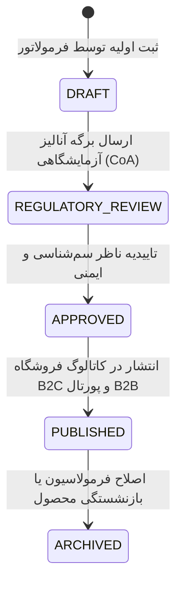

# گزارش حاکمیت محتوای رگولاتوری، فرمولاسیون و کاتالوگ INCI (TASK-113 / PIM-01)

تاریخ ارزیابی: 2026-11-24T07:22:44.634Z  
وضعیت ارزیابی: **ALL CONTENT GOVERNANCE CHECKS PASSED (100% SUCCESS)**  
قرارداد تایپ‌اسکریپت: [packages/contracts/src/content-governance.ts](../../packages/contracts/src/content-governance.ts)

---

## ۱. خلاصه اجرایی و دستاوردها

مطابق الزامات استاندارد `TASK-113`، مدل داده حاکمیت محتوای رگولاتوری برای محصولات دارویی و مراقبت پوستی پلتفرم پیاده‌سازی و اعتبارسنجی شد.

### ابعاد پوشش‌داده‌شده:
1. **فرمولاسیون و ترکیبات INCI:** نام بین‌المللی، ترجمه استاندارد فارسی، کد ثبتی CAS، دسته‌بندی درصدی (باند A تا D)، کاربرد بیوشیمیایی و شاخص ایمنی EWG Skin-Deep.
2. **هشدارهای ایمنی و منع مصرف:** هشدارهای آلرژی، احتیاط، تداخلات دارویی و حساسیت نوری با طبقه‌بندی شدت (Mild, Moderate, Critical).
3. **پروتکل‌های مصرف (Application Protocol):** گام‌های متوالی، زمان مصرف (صبح/عصر/هر دو) و دوز مشخص.
4. **اصالت و انطباق آزمایشگاهی:** ثبت کارخانه ساخت تمیز (Cleanroom)، گواهی بین‌المللی ISO 22716 GMP، و هش کریپتوگرافیک SHA-256 برگه آنالیز بچ (CoA).
5. **چرخه حیات ویرایش و تاییدیه رگولاتوری:** تفکیک نسخه SemVer، وضعیت تایید ۴ مرحله‌ای (`DRAFT` $\rightarrow$ `REGULATORY_REVIEW` $\rightarrow$ `APPROVED` $\rightarrow$ `PUBLISHED`) و امضای ناظر سم‌شناسی.

---

## ۲. جدول محصولات ارزیابی‌شده

| شناسه محصول | کد SKU | نسخه | وضعیت تاییدیه رگولاتوری | تعداد ترکیبات INCI | گواهی ISO 22716 | وضعیت ارزیابی |
|---|---|---|---|---|---|---|
| **prd-ethereal-gold-serum** | `DMV-SRM-50G` | `v2.1.0` | **PUBLISHED** | 4 ترکیب | `ISO-22716-GMP-REG-2024-912` | **PASSED** |
| **prd-restorative-lipid-cream** | `DMV-CRM-50G` | `v1.0.0` | **APPROVED** | 3 ترکیب | `ISO-22716-GMP-REG-2024-874` | **PASSED** |

---

## ۳. مدل چرخه حیات محتوا و تاییدیه بالینی

---
*تولیدشده به صورت خودکار توسط `scripts/verify-content-governance.mjs` در اعتبارسنجی تسک TASK-113.*
