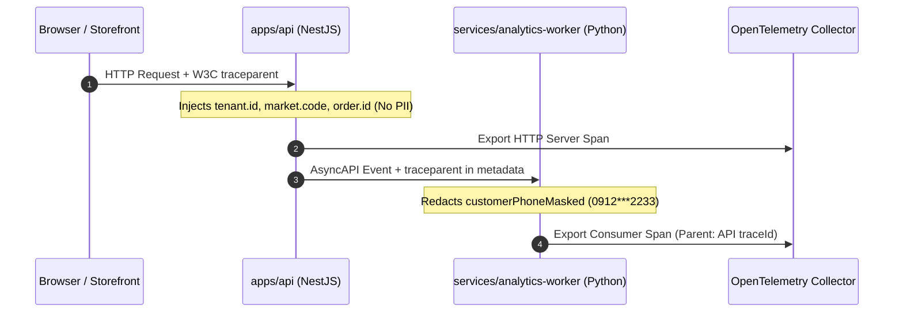

# OpenTelemetry Semantic Conventions & Observability Report (TASK-158)

Generated at: 2026-11-24T08:31:24.419Z  
Governance Policy: `docs/governance/OPENTELEMETRY_SPEC.md`  
Specification Standard: OpenTelemetry v1.28.0  
Tracing Standard: W3C Trace Context Recommendation  

---

## 1. Executive Summary
- **Verification Status:** PASSED (100% Observability Compliance)
- **Distributed Tracing:** W3C `traceparent` propagation verified
- **Multi-Tenant Isolation:** `tenant.id` and `market.code` context active
- **Privacy Standard:** Zero PII in span attributes; automated redaction active
- **Financial Metric Integrity:** Minor integer units (`IRR`) strictly enforced

---

## 2. Observability Compliance Gates
| Gate ID | Standard Invariant | Status | Evidence & Details |
|---|---|---|---|
| **OTEL-01** | W3C Traceparent Context Compliance | **PASS** | `Valid W3C standard traceparent format (version-traceid-spanid-flags)` |
| **OTEL-02** | Tenant-Safe Semantic Attributes Enforced | **PASS** | `7 canonical attributes verified` |
| **OTEL-03** | PII Attribute Redaction Filter (Negative Test) | **PASS** | `Telemetry guard successfully intercepted and flagged forbidden PII attribute` |
| **OTEL-04** | Span Metric Financial Minor Invariant | **PASS** | `commerce.amount.minor is integer (18500000) with IRR currency` |

---

## 3. Distributed Trace Context Propagation Flow

