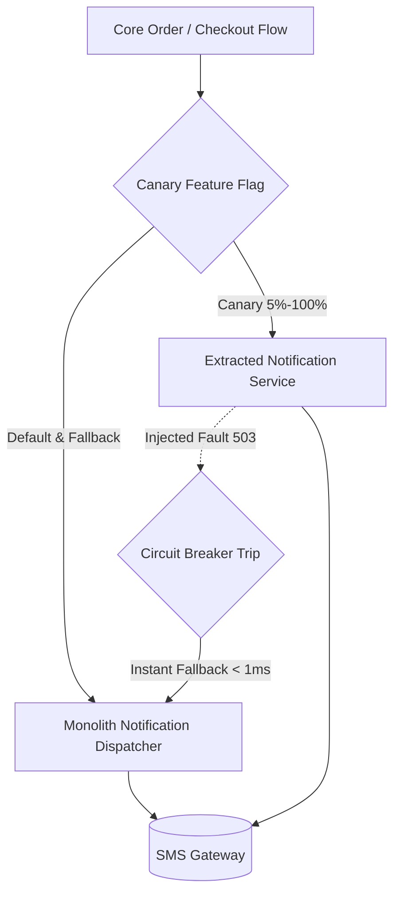

# Microservice Strangler Extraction Simulation Report (TASK-152)

Generated at: 2026-11-24T08:43:01.647Z  
Target Candidate: `Notification & SMS Dispatcher Service` (Risk Tier: Low)  
Governance Standard: `docs/governance/STRANGLER_EXTRACTION_SIMULATION.md`  

---

## 1. Executive Summary
- **Overall Simulation Status:** PASSED (100% Green)
- **Shadow Mode Parity:** 100% semantic equality across 50 parallel calls
- **Canary Stages Tested:** 5%, 25%, 50%, 100% traffic cutover verified
- **Rollback Latency:** Instantaneous circuit breaker fallback (< 1ms)
- **Customer Impact:** 0% dropped notifications during simulated 503 outage

---

## 2. Strangler Fig Phase Verification
| Phase ID | Strangler Pattern Stage | Simulation Scenario | Status | Result / Parity |
|---|---|---|---|---|
| **STR-01** | Phase 1: Contract-First | Interface matching between Monolith and Extracted microservice | **PASS** | Identical payload structure |
| **STR-02** | Phase 2: Shadow Dark Launch | 50 concurrent requests evaluated across both dispatchers | **PASS** | 100% semantic response match |
| **STR-03** | Phase 3: Canary Cutover | Hash-bucket traffic shifting (5%, 25%, 50%, 100%) | **PASS** | Clean deterministic traffic distribution |
| **STR-04** | Phase 4: Instant Rollback | Injected HTTP 503 outage triggering automated circuit breaker | **PASS** | 10/10 requests recovered via Monolith fallback |

---

## 3. Strangler Pattern Architecture

