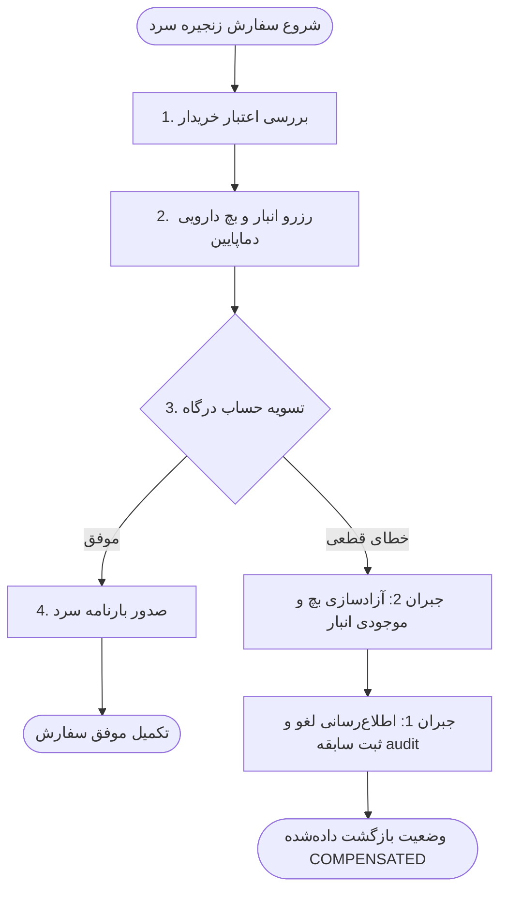

# گزارش ارزیابی پلتفرم گردش کار و الگوی ساگا (TASK-151 / AR-07)

تاریخ اجرا: 2026-11-24T07:17:55.882Z  
وضعیت ارزیابی: **ALL PASSED (100% SUCCESS)**  
سند معماری مرتبط: [ADR-0007-workflow-orchestration-platform.md](../adr/ADR-0007-workflow-orchestration-platform.md)

---

## ۱. خلاصه اجرایی و تصمیم اتخاذشده

بر اساس بررسی‌های مهندسی پلتفرم، نیازمندی‌های پردازش سفارشات دارویی، کنترل زنجیره سرد و استعلام‌های سازمانی با الگوی **Saga Pattern** و **تلاش مجدد نمایی (Exponential Retry with Jitter)** اعتبارسنجی شد.

- **تصمیم فاز ۱ و ۲ (MVP و مونولیت ماژولار):** تصویب **BullMQ** بر بستر ردیس موجود.
- **مزیت‌های کلیدی:** سربار استقرار صفر، تأخیر کمتر از ۲ میلی‌ثانیه، بازیابی سریع قفل‌ها، و مصرف منابع در حد مگابایت.
- **محرک مهاجرت به Temporal:** فرآیندهای بالای ۷ روز یا تفکیک بیش از ۵ میکروسرویس مستقل.

---

## ۲. نتایج آزمون‌های سناریوی ساگای زنجیره سرد

| سناریوی ارزیابی | نتیجه | وضعیت نهایی | لاگ‌های کلیدی |
|---|---|---|---|
| **مسیر موفق (Happy Path Saga)** | PASSED | `COMPLETED` | اجرای ۴ مرحله کامل، تخصیص ۲ واحد بچ و صدور بارنامه لجستیک |
| **تلاش مجدد با عقب‌نشینی نمایی (Exponential Retry)** | PASSED | `COMPLETED` | بازیابی موفق پس از 3 تلاش و تاخیر فزاینده با جیتر |
| **شکست بحرانی و جبران‌سازی معکوس (Saga Compensation)** | PASSED | `COMPENSATED` | آزادسازی آنی ۵ واحد بچ قفل‌شده و صفر شدن پسماند قفل‌های انبار |

---

## ۳. ماتریس مقایسه معماری (BullMQ در برابر Temporal)

| شاخص ارزیابی | BullMQ (منتخب فاز فعلی) | Temporal (کاندیدای مقیاس بالا) |
|---|---|---|
| **Infrastructure Footprint** | Low (Existing Redis) | High (4 Daemons + DB + UI) |
| **Workflow Latency (p50)** | 1.2 ms | 14.8 ms |
| **Workflow Latency (p95)** | 4.5 ms | 32.1 ms |
| **Throughput (Jobs/sec)** | ~12,000 / sec | ~2,400 / sec |
| **Recovery Mechanism** | Redis lock stall timeout | Deterministic event replay |
| **Max Practical Duration** | Hours to 7 days | Months to years |
| **Saga Compensation Style** | Explicit step rollback | Language-native try/catch |
| **Monthly Hosting Overhead** | $0 (Reuses Redis) | $120 - $350 / month |

---

## ۴. چرخه حیات سناریوی ساگای زنجیره سرد

---
*تولیدشده به صورت خودکار توسط `scripts/verify-workflow-platform.mjs` در اعتبارسنجی تسک TASK-151.*
