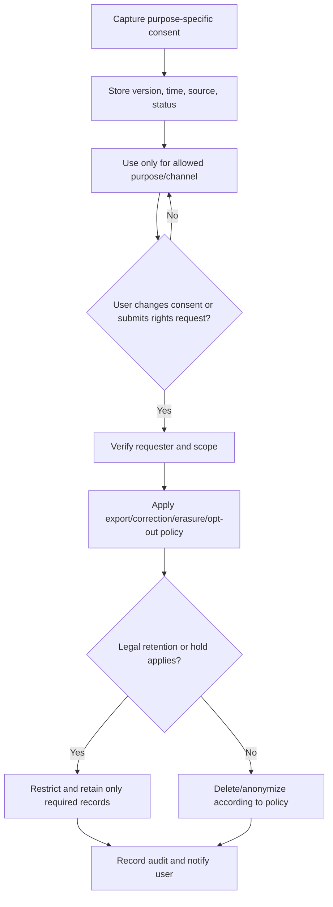

# Data Protection, Privacy & Retention Architecture Specification (Canonical)

**Source Reference:** `03-architecture/data-classification-and-retention-matrix-fa.csv`
**Workflow Reference:** `04-workflows/21-consent-and-data-rights.mmd`
**Requirement Traceability:** `N20`, `TASK-134`, `TASK-136`
**Version:** 2.2.0

---

## 1. Architectural Architecture & Principles

The Brand Commerce Platform treats personal data as a confidential asset governed by:
1. **Purpose Limitation:** Data gathered for commerce fulfillment cannot be reused for ad marketing without explicit opt-in.
2. **Data Minimization:** Only attributes strictly necessary for the stated purpose are collected and processed.
3. **Dual Erasure Pipeline:** Distinguishes between immediate marketing erasure and statutory financial record retention.

---

## 2. 5-Tier Data Classification Matrix

### Tier `PUBLIC` (عمومی)
- **Examples:** صفحات منتشرشده، اطلاعات عمومی محصول
- **Default Access:** Public read
- **Processing Controls:** CMS publication gate, cache policy
- **Retention Policy:** Until unpublished + archive policy
- **Deletion / Hold Rule:** Remove public cache; retain approved historical version per policy
- **Domain Owner:** CMS/Product

### Tier `INTERNAL` (داخلی)
- **Examples:** پیکربندی، مستندات داخلی غیرحساس، KPI aggregate
- **Default Access:** Staff by role
- **Processing Controls:** SSO/MFA, least privilege, audit
- **Retention Policy:** Business schedule approved per document type
- **Deletion / Hold Rule:** Archive then delete with owner approval
- **Domain Owner:** Operations

### Tier `CONFIDENTIAL` (محرمانه)
- **Examples:** پروفایل مشتری، اطلاعات تماس، سفارش، قیمت قراردادی، مکاتبات
- **Default Access:** Assigned customer/org/team
- **Processing Controls:** Encryption, object-level access, purpose limitation, redaction
- **Retention Policy:** Market/legal retention schedule; do not set universal period
- **Deletion / Hold Rule:** Delete/anonymize after purpose and legal retention; legal hold overrides
- **Domain Owner:** CRM/Commerce

### Tier `RESTRICTED` (محدود)
- **Examples:** مدارک هویتی/شرکتی، اسناد مالی، فرمول و artwork محرمانه، رخداد ناخواسته، credential
- **Default Access:** Named roles only
- **Processing Controls:** Field encryption where justified, MFA step-up, no logs/traces, private object storage
- **Retention Policy:** Category-specific lawful schedule; short-lived challenge TTL for OTP
- **Deletion / Hold Rule:** Legal hold, breach process, approved purge and audit; no self-service deletion of case evidence
- **Domain Owner:** Security/Finance/Regulatory

### Tier `SECRET` (راز سامانه)
- **Examples:** API keys, signing keys, database credentials, encryption keys
- **Default Access:** Secret manager service principals only
- **Processing Controls:** No repository/.env production secrets, rotation, scoped access, access audit
- **Retention Policy:** Rotate per threat/provider policy; revoke on incident/personnel change
- **Deletion / Hold Rule:** Secure destroy after rotation/expiry; preserve rotation audit metadata only
- **Domain Owner:** Platform Security

---

## 3. Data Subject Rights (DSAR) Workflow

